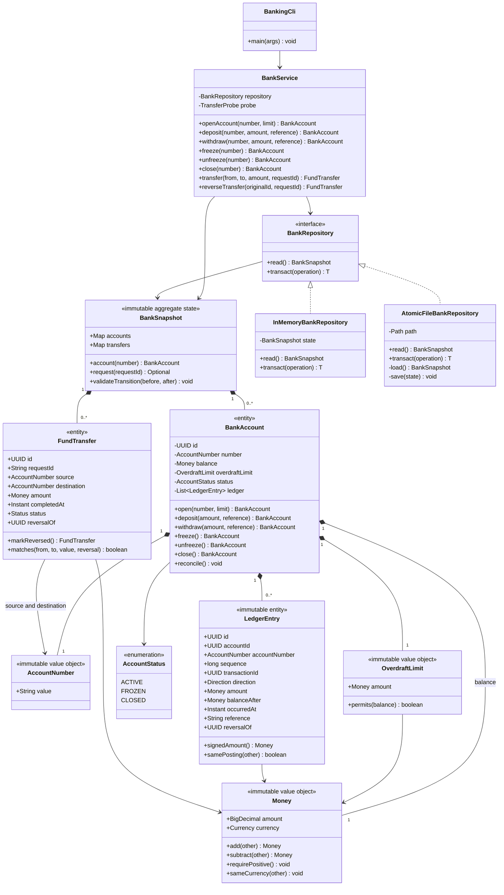
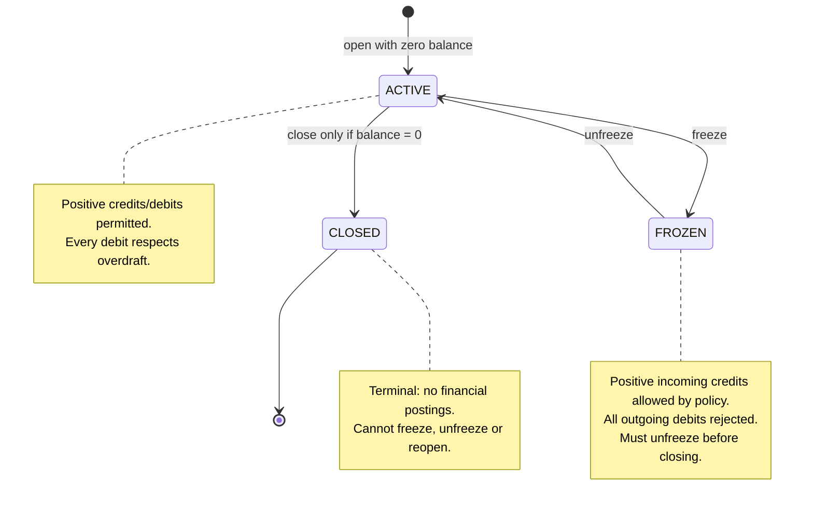

# UML — implemented Java model

GitHub renders the Mermaid diagrams below. Names correspond to classes in `banking-java/src/main/java/com/paysmart/bank/`.

## Class diagram



All record components shown as public accessors are immutable values, not writable public fields. Account identity remains stable while operations return new versions. Ledger-entry and transfer equality follows ID; value-object equality follows canonical contents.

## Account lifecycle



## Same-bank transfer and failure boundary

```mermaid
sequenceDiagram
    actor Caller
    participant Service as BankService
    participant Repo as BankRepository
    participant A as Account A
    participant B as Account B
    participant Disk as Atomic bank snapshot
    Caller->>Service: transfer(A, B, INR 5000, requestId)
    Service->>Repo: transact(callback)
    Repo->>Repo: acquire lock and read latest state
    Repo->>Service: execute callback with immutable snapshot
    Service->>Service: check request ID and payload
    Service->>A: post(DEBIT, amount, transferId)
    A-->>Service: candidate A with debit entry
    Note over Service,Disk: Failure here publishes nothing; old A/B remain committed
    Service->>B: post(CREDIT, amount, transferId)
    B-->>Service: candidate B with credit entry
    Service-->>Repo: complete validated candidate and transfer
    Repo->>Repo: enforce append-only transition rules
    Repo->>Disk: write complete temporary snapshot and force file
    Repo->>Disk: atomic rename and force directory
    Repo-->>Service: committed result
    Service-->>Caller: completed transfer
    Note over Caller,Disk: If reply is lost, retry SAME request ID; return original result
```

If a validation exception occurs before commit, the callback exits and the repository does not publish the candidate. A failure after rename may be an uncertain outcome; idempotent retry, not a blind second instruction, resolves it.

## Production cross-bank conceptual sequence

This last diagram is a **proposed integration design**, not implemented network functionality.

```mermaid
sequenceDiagram
    participant A as Sending bank
    participant Outbox as Durable outbox
    participant Rail as Settlement network
    participant B as Receiving bank
    A->>A: reserve/debit into clearing and persist instruction
    A->>Outbox: write stable end-to-end ID in same local transaction
    Outbox->>Rail: dispatch and retry same instruction ID
    Rail->>B: idempotent receive/credit
    B-->>Rail: authenticated outcome
    Rail-->>A: outcome or pending status
    alt Confirmed success
        A->>A: finalize local transfer and clearing entries
    else Definitive rejection
        A->>A: compensate/release reservation exactly once
    else Timeout or unknown
        A->>Rail: query and reconcile; keep pending
    end
```
